# YumQuick

**YumQuick** is a Flutter food-delivery app: browse meals by category, customise a dish with toppings, add it to the cart, pay by cash or card (Stripe), and track your orders, all in a warm yellow-and-orange UI.

## Features

- **Auth**: email/mobile sign up and login, plus Google Sign-In; the session token is kept in secure storage
- **Onboarding & splash** screens
- **Home**: categories (Meals, Snacks, Vegan, Desserts, Drinks), offer banners, recommended and best-seller dishes, search
- **Product details**: quantity selector and toppings
- **Favorites**: save the dishes you love
- **Cart & checkout**: edit the cart, pick a delivery address, choose cash or card, review the order summary
- **Payments**: save and manage cards through Stripe
- **My orders**: active, completed, and cancelled tabs, with cancel, re-order, and leave-a-review actions
- **Help center**: FAQs, contact form, and support issues with a live chat thread
- **Side menu**: profile, delivery addresses, payment methods, contact us, help, and settings
- **Push notifications** via Firebase Cloud Messaging

## Screenshots

<p align="center">
  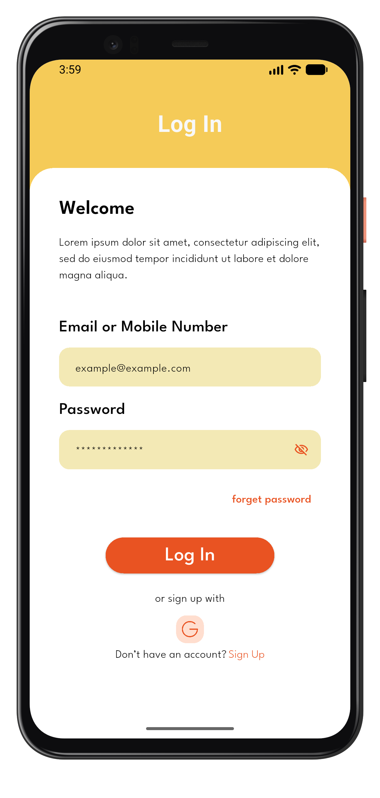
  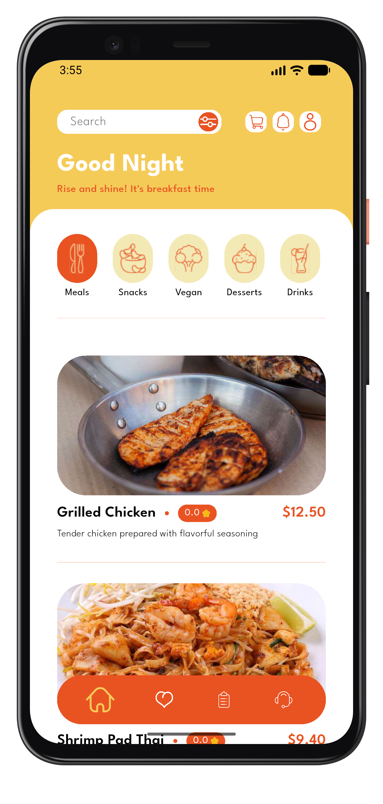
  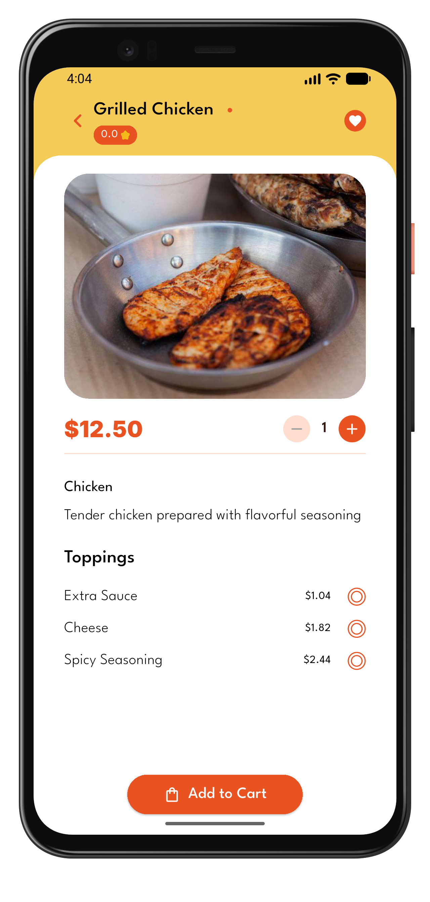
  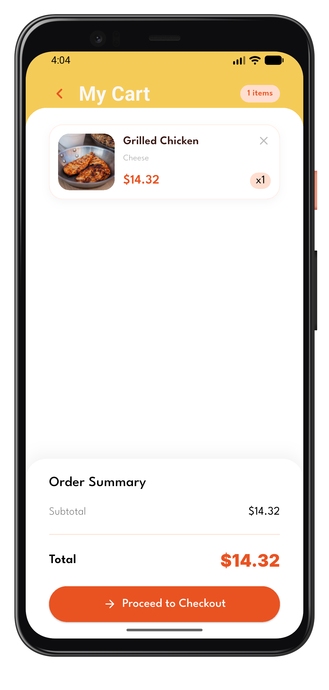
  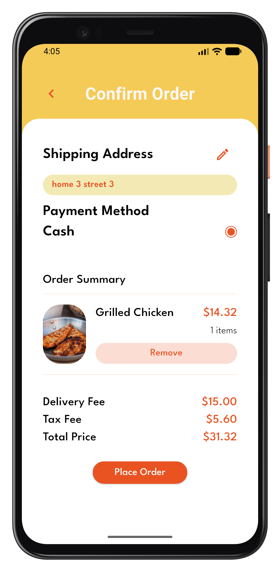
  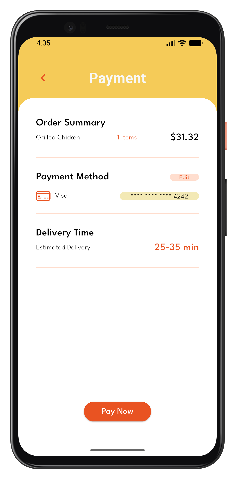
</p>

<p align="center">
  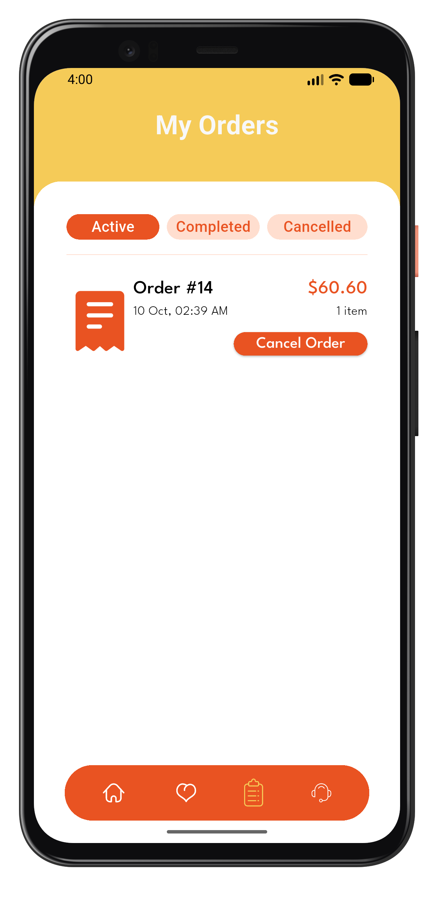
  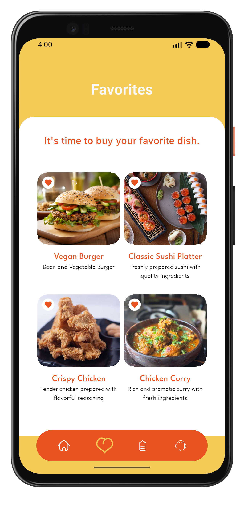
  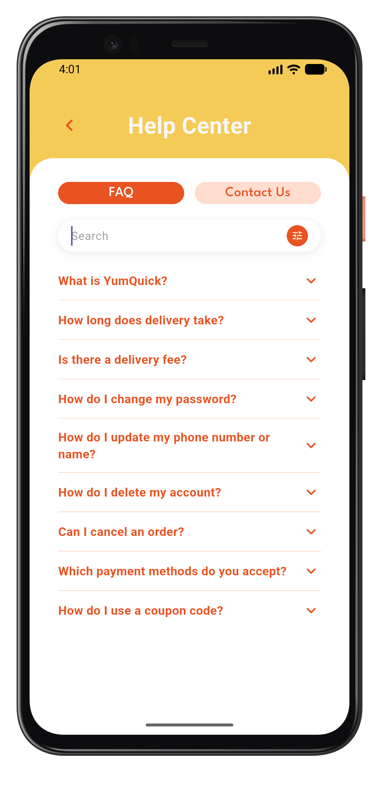
  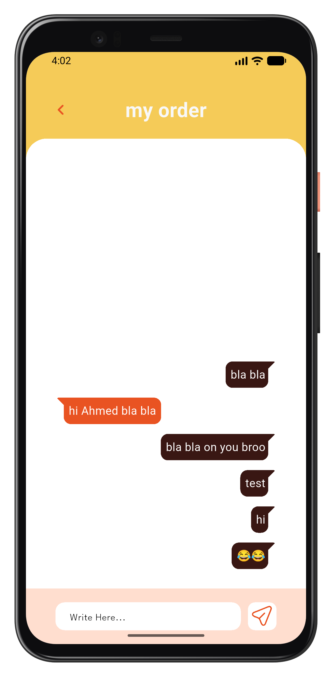
  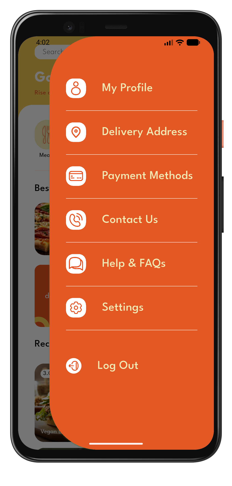
</p>

## Tech stack

| Area | Packages |
| --- | --- |
| State management | `flutter_bloc`, `freezed` |
| Networking | `dio`, `retrofit`, `pretty_dio_logger` |
| Dependency injection | `get_it` |
| Payments | `flutter_stripe` |
| Auth & storage | `google_sign_in`, `flutter_secure_storage`, `shared_preferences` |
| Notifications | `firebase_core`, `firebase_messaging`, `flutter_local_notifications` |
| UI | `flutter_screenutil`, `flutter_svg`, `google_fonts`, `skeletonizer`, `chat_bubbles` |
| Config | `envied` (obfuscated `.env` values) |

## Project structure

```
lib/
├── core/        # routing, DI, networking, notifications, theme, helpers, shared widgets
├── features/
│   ├── auth/  onboarding/  home/  favorites/  cart/
│   ├── checkout/  my-orders/  help/  side menu screens/
│   └── ...      # each feature: data/ (models, repos) -> logic/ (Cubit) -> ui/
├── env.dart     # typed access to .env values
└── main.dart
```

## Getting started

1. Clone the repo and install dependencies:

   ```bash
   git clone https://github.com/Ahmed2004abdelal/yumquick.git
   cd yumquick
   flutter pub get
   ```

2. Create a `.env` file in the project root:

   ```env
   API_URL=<your backend base url>
   StripePublishableKey=<your Stripe publishable key>
   serverClientId=<your Google OAuth server client id>
   ```

3. Generate code (models, Retrofit client, env, freezed states):

   ```bash
   dart run build_runner build --delete-conflicting-outputs
   ```

4. Run the app:

   ```bash
   flutter run
   ```

Requires Flutter with Dart SDK `^3.13.2`. Push notifications also need your own Firebase configuration (`google-services.json` for Android).

## More docs

- [`ORDER_FEATURE_REPORT.md`](ORDER_FEATURE_REPORT.md): how the order and payment flow is built
- [`AGENTS.md`](AGENTS.md): architecture notes and conventions
